<div align="center">

# 🔐 Cybersecurity Lab Environment Setup

**Building an isolated virtual lab for penetration testing and ethical hacking practice**
</div>


---

## 📌 Project Overview

This project focuses on setting up a **virtual cybersecurity and penetration-testing laboratory** using VirtualBox. It includes a Kali Linux Security OS alongside Windows 10 and Android 9.0 machines.

The purpose of the lab is to create a controlled environment where cybersecurity tools, network scanning, reconnaissance, vulnerability assessment, and other security-testing activities can be performed safely and repeatedly.

The lab is configured on a private virtual network so that machines can communicate with each other securely while being isolated from the host machine.

---

## 🎯 Objectives

The main objectives of this project are to:

- Install and configure VirtualBox.
- Verify and import the Kali Linux virtual machine.
- Deploy Windows 10 and Android 9.0 as test virtual machines.
- Create a private **NAT Network** for the cybersecurity lab.
- Configure manual IP addressing for all virtual machines.
- Verify cross-machine network connectivity and internet access via ICMP pings.
- Take a clean VM snapshot for recovery.
- Document the complete setup process.

---

## 🛡️ Purpose of the Lab

The lab provides an isolated and controlled environment for cybersecurity learning and authorized security testing.

It can be used for activities such as:

- Network reconnaissance
- Port scanning
- Vulnerability assessment
- Packet analysis
- Web security testing
- Exploitation practice
- Security-tool experimentation

⚠️ **Important:** This laboratory must only be used for systems that you own or have explicit permission to test. Do not use the lab or its tools to attack unauthorized systems.

---

## 🏗️ Lab Architecture

The lab consists of a virtualized network connecting a Security OS and two testing machines.


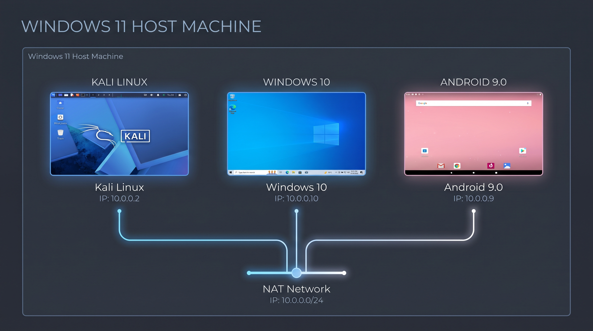

Additional target machines can be added to the same virtual network in future projects.

---

## ⚙️ Lab Configuration

| 🧩 Component       | ⚙️ Configuration   |
| ------------------ | ------------------  |
| 🧰 Hypervisor      | Oracle VirtualBox  |
| 🌐 Virtual Network | NAT Network        |
| 📡 Network Address | 10.0.0.0/24        |
| 🚪 Default Gateway | 10.0.0.1           |
| 🌍 DNS Server      | 8.8.8.8            |
| 🐉 Security OS     | Kali Linux         |
| 🐧 Kali IP Address | 10.0.0.2/24        |
| 🖥️ Target OS 1     | Windows 10         |
| 💻 Windows IP      | 10.0.0.10/24       |
| 📱 Target OS 2     | Android 9.0 (x86)  |
| 📱 Android IP      | 10.0.0.9/24        |

---

# 🪜 Lab Setup Procedure

## Step 1. Install 7-Zip

7-Zip was installed to extract the compressed virtual-machine packages and ISO files required for the lab setup.

**Tool:** 7-Zip

---

## Step 2. Verify File Integrity

Before importing, the integrity of the downloaded Kali Linux virtual machine image was verified using a SHA256 checksum to ensure authenticity and prevent corruption.

**Command:**
```cmd
certutil -hashfile "kali-linux-iso-file" SHA256
```


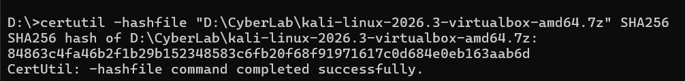

---

## Step 3. Create the NAT Network

A dedicated NAT Network was created in VirtualBox to ensure all VMs could communicate with each other while maintaining internet access.

Configuration:
```text
Network Name: NatNetwork
IPv4 Prefix:  10.0.0.0/24
DHCP:         Enabled
IPv6:         Disabled
```


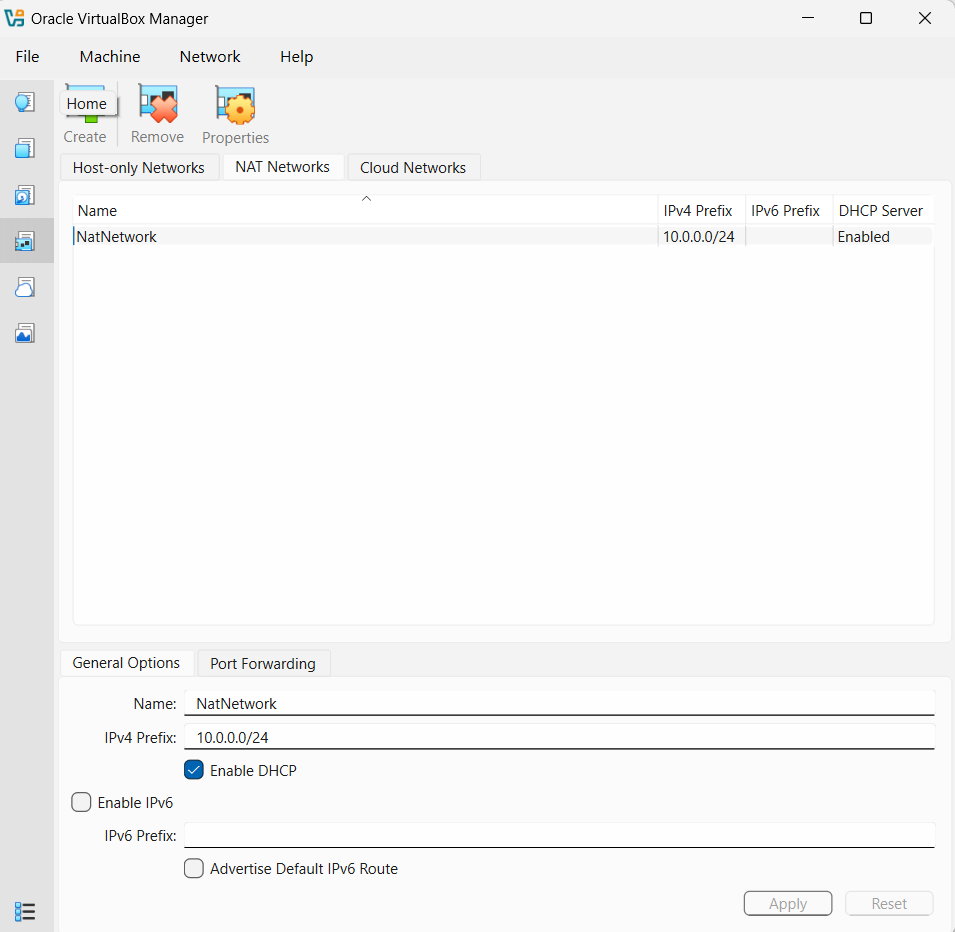

---

## Step 4. Import Virtual Machines

The operating systems were successfully imported and built within the VirtualBox hypervisor. 

- **Kali Linux Import:**

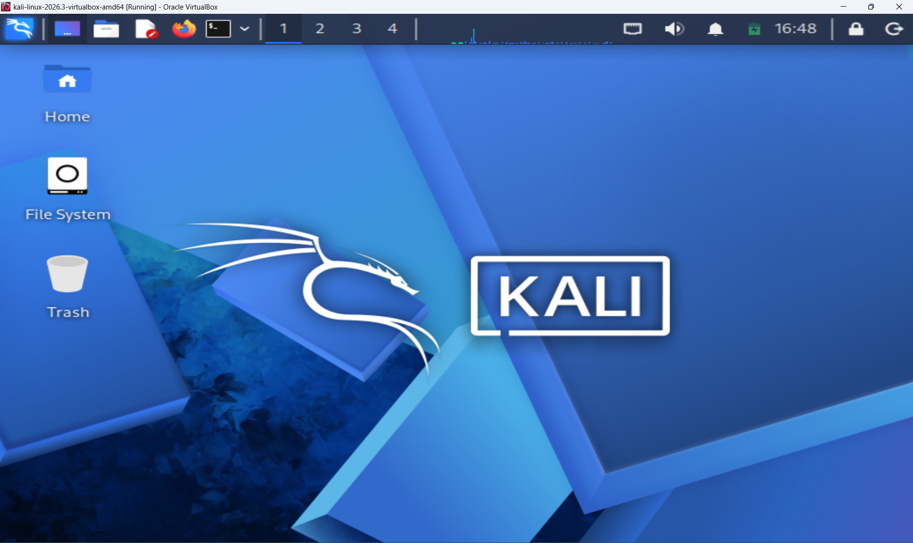

- **Windows 10 Import:**

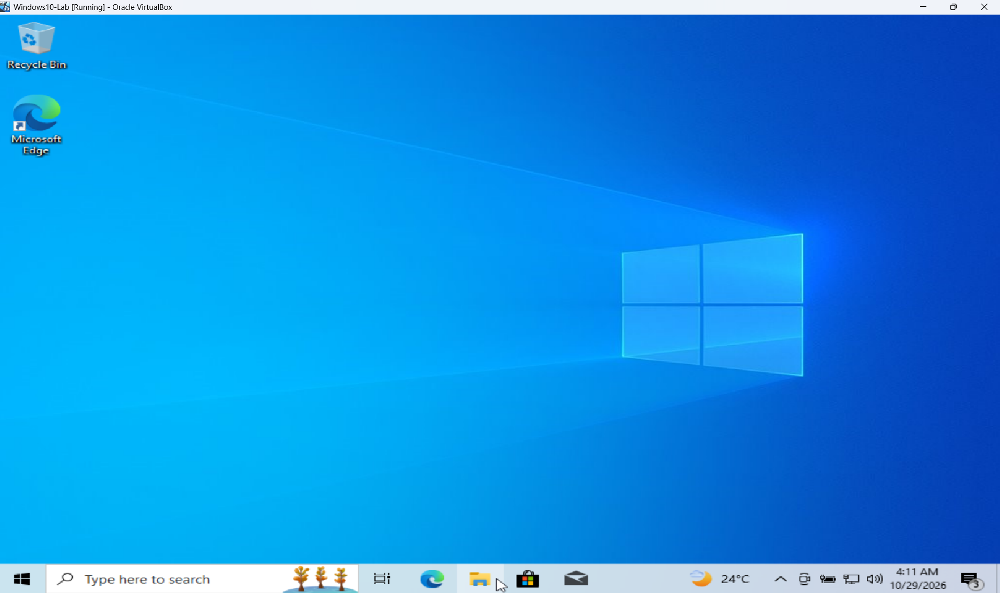

- **Android 9.0 Import:**

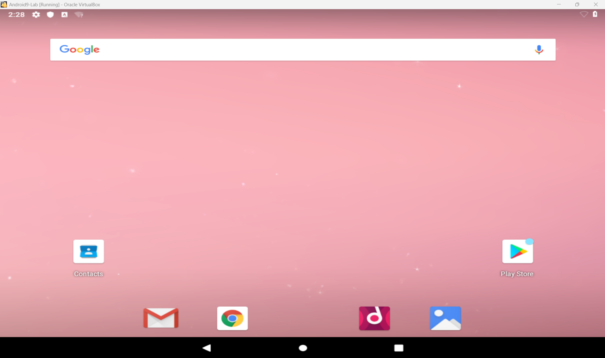

---

## Step 5. Configure Virtual Machine Networks

Each VM's network adapter was attached to the `NatNetwork`, and static IPs were manually assigned to establish a predictable testing environment.

- **Kali Linux Network & IP Configuration (10.0.0.2):**

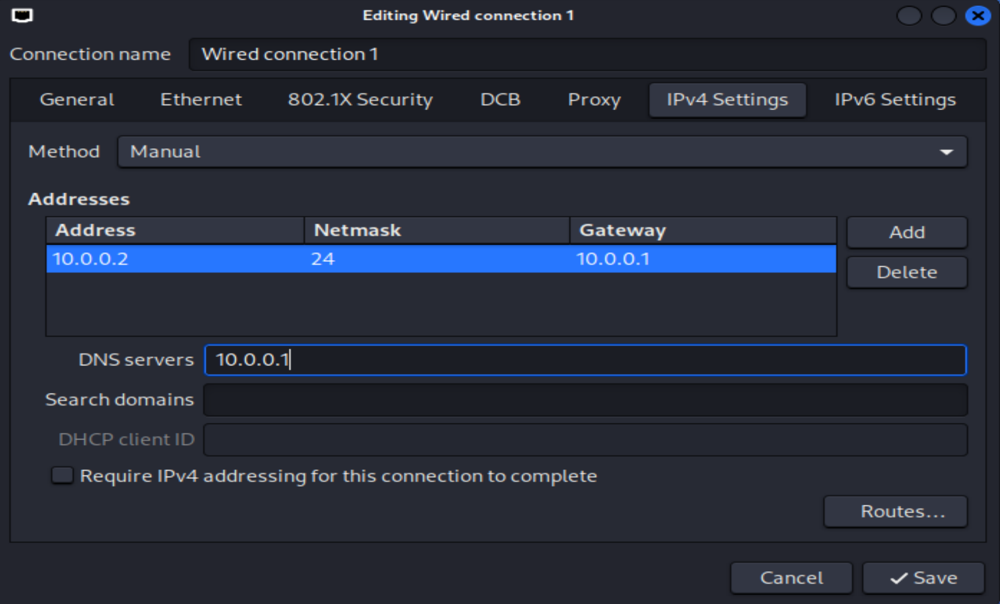

- **Windows 10 Network & IP Configuration (10.0.0.10):**

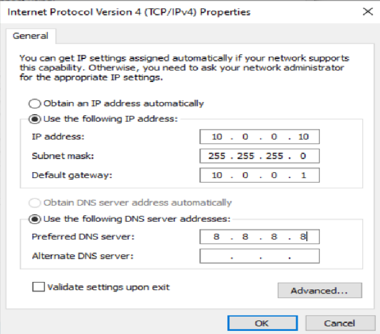

- **Android 9.0 Network & IP Configuration (10.0.0.9):**

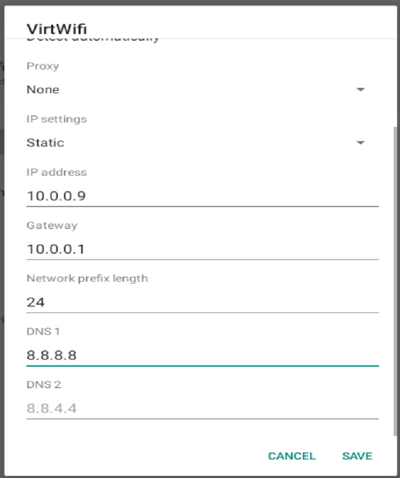

---

## Step 6. Create a Clean VM Snapshot

After completing the initial configuration, a VirtualBox snapshot was created for Kali Linux.

The snapshot represents the clean baseline of the laboratory. If a future exercise changes or damages the VM configuration, the machine can be restored to this baseline safely.


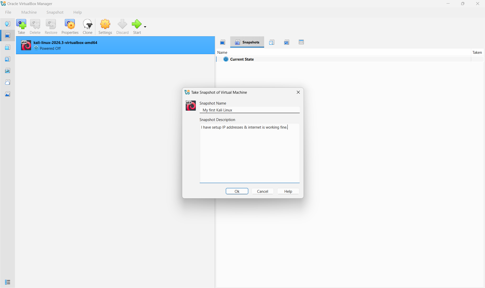

---

# 🔎 Lab Verification

To ensure the network was functioning correctly, ICMP echo requests (pings) were performed across the environment.

| ✅ Test                            | 🎯 Expected Result | 📊 Actual Result |
| ---------------------------------- | ------------------ | ---------------- |
|    Kali ping Windows 10            | Successful replies | Success          |
|    Kali ping Android 9.0           | Successful replies | Success          |
|    Win 10 ping Kali & Internet     | Successful replies | Success          |
|    Android ping Kali & Internet    | Successful replies | Success          |

### Verification Evidence

- **Kali to Windows 10**
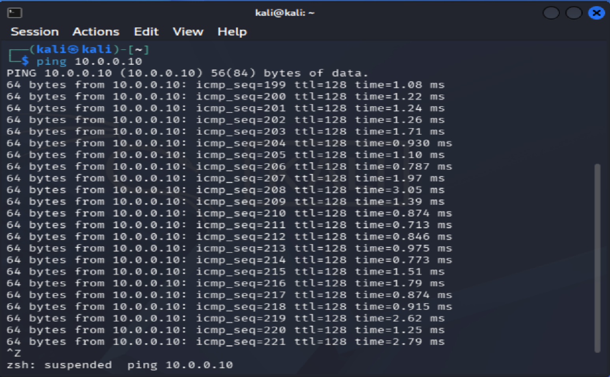

- **Kali to Android**
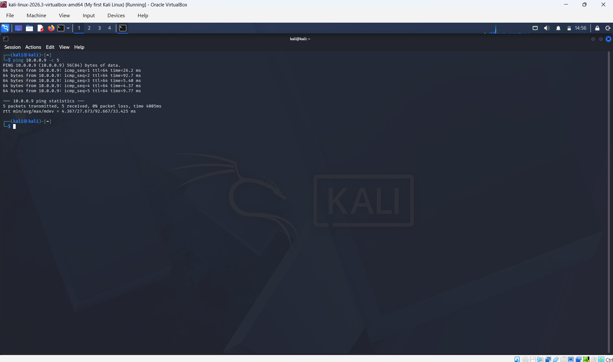

- **Windows 10 to Kali and Internet (8.8.8.8)**
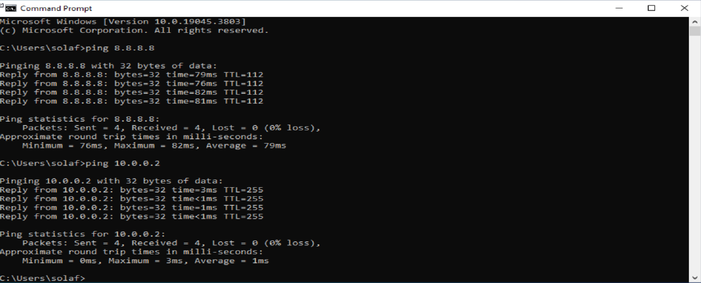

- **Android to Kali and Internet (8.8.8.8)**
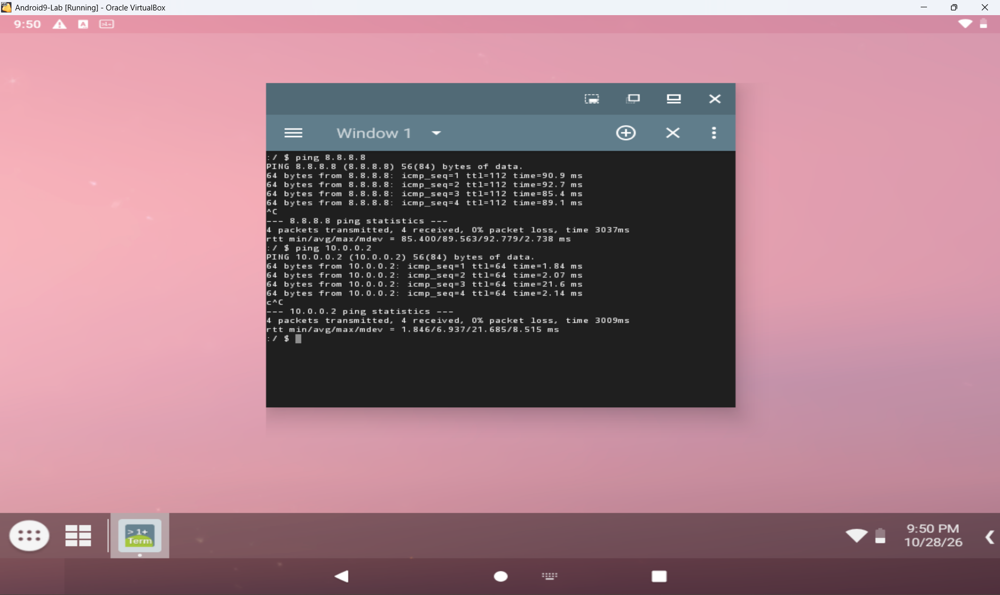

---

# 🐞 Problems Encountered & Solutions

Documenting problems is an important part of the project. Here are the issues resolved during this lab setup:

## Problem 1. Kali Linux could not ping Windows 10
- **Cause:** Windows Defender Firewall blocks incoming ICMP (ping) traffic by default.
- **Resolution:** Modified the Windows Firewall rules to allow inbound `File and Printer Sharing (Echo Request - ICMPv4-In)`, which successfully established connectivity.

---

## Problem 2. Android VM booted to a black screen
- **Cause:** VirtualBox graphics controller and resource incompatibility with the Android-x86 image.
- **Resolution:** Powered off the VM, adjusted the display settings to use the **VBoxSVGA** graphics controller, unchecked **3D Acceleration**, and increased the allocated CPU count to 3. The OS rendered correctly upon reboot.

---

## Problem 3. Kali Linux had no internet connectivity
- **Cause:** Known internet connectivity issue occurring with VirtualBox v7 and Kali Linux 2026.1 or higher.
- **Resolution:** Modified the NetworkManager configuration to disable the IPv4 DAD timeout, then brought the connection down and back up.
```cmd
sudo nmcli connection modify "Wired connection 1" ipv4.dad-timeout 0
sudo nmcli connection down "Wired connection 1"
sudo nmcli connection up "Wired connection 1"
```

---

# 💡 What I Learned

Through this project, I learned how to create and configure a virtual environment for cybersecurity practice. The most important concepts I learned include:

### 1. Advanced Virtualization Troubleshooting
I learned how to diagnose OS boot failures (like the Android black screen) by adjusting hypervisor hardware settings such as graphics controllers and CPU allocation.

### 2. Virtual Machine Networking
I learned how VirtualBox virtual network adapters connect virtual machines to different types of networks and how network configuration affects communication between machines.

### 3. Static IP Configuration
I learned how to configure and verify IPv4 addressing, subnet masks, gateways, and DNS settings across three completely different operating systems (Linux, Windows, Android).

### 4. Firewall Rule Management
I gained hands-on experience diagnosing blocked network traffic and implementing specific firewall exceptions in Windows Defender to allow ICMP requests.

### 5. VM Snapshots
I learned that a clean snapshot should be created **before performing risky or experimental activities**. This provides a known-good recovery point for future cybersecurity exercises.

---

# 🔐 Security & Ethical Use

This laboratory is intended strictly for education purposes only.

---

# 🔗 Tools & Resources

- **7-Zip:** [https://7-zip.org/download.html](https://7-zip.org/download.html)
- **VirtualBox:** [https://virtualbox.org/wiki/Downloads](https://virtualbox.org/wiki/Downloads)
- **Kali Linux:** [https://kali.org/get-kali](https://kali.org/get-kali)
- **Windows 10:** [https://www.microsoft.com/en-us/software-download/windows10](https://www.microsoft.com/en-us/software-download/windows10)
- **Android:** [https://www.android-x86.org/download](https://www.android-x86.org/download)

---

# 👤 Author

**Sulafa Abdulrahman**\
SOC Analyst L1

LinkedIn: https://www.linkedin.com/in/sulafa-abdulrahman

---

## 📌 Project Information

**Program Name:** Cybersecurity at Networkwalks | **Week:** 01 | **Project:** Cybersecurity & Pentesting Lab Setup | **Repository:** GitHub
